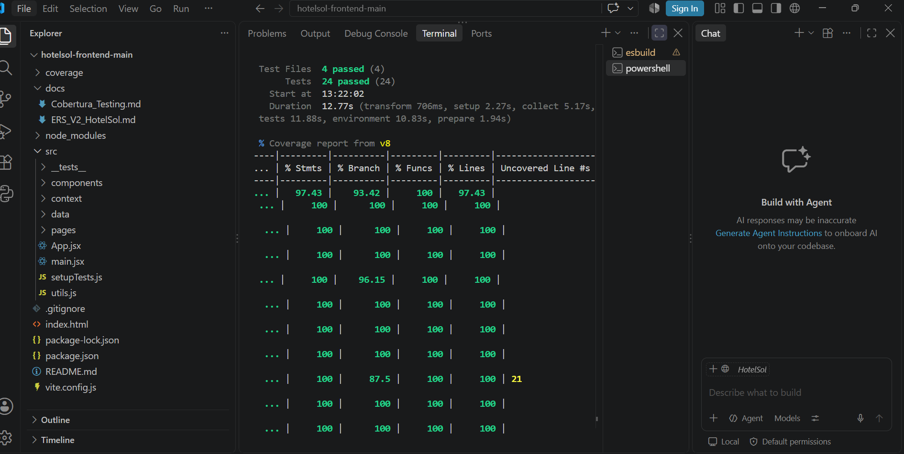
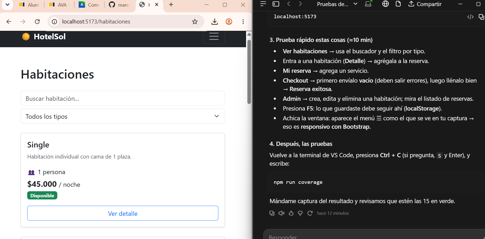

# Documento de Cobertura de Testing

**Proyecto:** HotelSol — Frontend en React
**Asignatura:** DSY1104 Desarrollo Fullstack II — Evaluación Parcial 2
**Autora:** Marcela Sepúlveda Huircán
**Fecha:** 25 de octubre de 2026

---

## 1. Herramientas utilizadas

| Herramienta | Para qué se usa |
|---|---|
| **Vitest** | Ejecutar las pruebas unitarias (integrado con Vite). |
| **jsdom** | Simula el navegador (DOM y `localStorage`) dentro de las pruebas. |
| **React Testing Library** | Renderizar componentes y buscarlos como lo haría el usuario (por texto, rol o etiqueta). |
| **@testing-library/user-event** | Simular acciones reales: escribir, hacer clic, elegir opciones. |
| **@testing-library/jest-dom** | Comparaciones como `toBeInTheDocument()` o `toHaveTextContent()`. |
| **vi.fn() / vi.spyOn()** | Mocks: funciones simuladas para comprobar que se llamaron y con qué datos. |
| **@vitest/coverage-v8** | Generar el reporte de cobertura. |

## 2. Configuración del entorno

Instalación de dependencias de prueba:

```bash
npm install -D vitest jsdom @testing-library/react @testing-library/jest-dom @testing-library/user-event @vitest/coverage-v8
```

Configuración en `vite.config.js`:

```js
test: {
  environment: 'jsdom',              // simula el navegador
  globals: true,                     // describe, it, expect sin importar
  setupFiles: './src/setupTests.js', // carga jest-dom y limpia localStorage
  coverage: {
    provider: 'v8',
    include: ['src/**/*.{js,jsx}'],
    exclude: ['src/main.jsx', 'src/setupTests.js', 'src/__tests__/**'],
    thresholds: { lines: 80, branches: 80, functions: 80, statements: 80 },
  },
}
```

El umbral (`thresholds`) hace que el comando falle si la cobertura baja de **80%**.

Comandos:

```bash
npm test           # ejecuta las pruebas
npm run coverage   # ejecuta las pruebas y genera el reporte (carpeta coverage/)
```

---

## 3. Resultado de la ejecución

```
 Test Files  4 passed (4)
      Tests  24 passed (24)
```

**24 pruebas, 24 aprobadas, 0 fallidas.**

### Cobertura total

| Métrica | Resultado | Umbral | Estado |
|---|---|---|---|
| Sentencias (Statements) | **97,43%** | 80% | ✅ Cumple |
| Ramas (Branches) | **93,42%** | 80% | ✅ Cumple |
| Funciones (Functions) | **100%** | 80% | ✅ Cumple |
| Líneas (Lines) | **97,43%** | 80% | ✅ Cumple |

### Cobertura por carpeta

| Carpeta | Sentencias | Ramas | Funciones | Líneas |
|---|---|---|---|---|
| `src` (App, utils) | 100% | 100% | 100% | 100% |
| `src/components` | 100% | 96,15% | 100% | 100% |
| `src/context` | 100% | 88,88% | 100% | 100% |
| `src/data` (BD simulada) | 100% | 91,83% | 100% | 100% |
| `src/pages` | 95,01% | 93,61% | 100% | 95,01% |
| `src/pages/admin` | 98,5% | 93,93% | 100% | 98,5% |

### Evidencia de ejecución (27 de octubre de 2026)

Capturas tomadas al ejecutar el proyecto descargado desde este repositorio, después de `npm install`.

**Pruebas y cobertura** (`npm run coverage`): 4 archivos de prueba, 24 pruebas aprobadas.



**Aplicación funcionando** (`npm run dev`, vista Habitaciones en `localhost:5173`):



---

## 4. Detalle de las pruebas

Las pruebas están en `src/__tests__/` y se agrupan en 4 archivos.

### 4.1 `db.test.js` — Base de datos simulada (5 pruebas)

| # | Prueba | Qué verifica |
|---|---|---|
| 1 | Carga las 6 habitaciones iniciales del caso | Lectura de datos (HB001–HB006). |
| 2 | Crea, actualiza y elimina una habitación | CRUD completo y persistencia en localStorage. |
| 3 | No permite código repetido ni actualizar una inexistente | Manejo de errores del CRUD. |
| 4 | Evita la sobreventa | Rechaza fechas que se cruzan con una reserva activa (RS002 en HB005). |
| 5 | Calcula noches, cruces y reinicia la base | Funciones auxiliares `calcularNoches`, `hayCruce`, `reiniciarDB`. |

### 4.2 `componentes.test.jsx` — Componentes reutilizables (5 pruebas)

| # | Prueba | Tipo de prueba |
|---|---|---|
| 6 | `Boton` muestra la etiqueta recibida y ejecuta `onClick` | **Props + evento + mock (`vi.fn`)** |
| 7 | `ListaHabitaciones` renderiza todas las habitaciones recibidas | **Renderizado** de lista |
| 8 | `ListaHabitaciones` muestra un aviso cuando la lista está vacía | **Renderizado condicional** |
| 9 | La tarjeta muestra la insignia de oferta solo si está en oferta | **Renderizado condicional + props** |
| 10 | `Filtros` avisa al padre cuando el usuario escribe o elige un tipo | **Eventos + mocks (`vi.fn`)** |

### 4.3 `paginas.test.jsx` — Vistas y flujos (6 pruebas)

| # | Prueba | Tipo de prueba |
|---|---|---|
| 11 | El buscador filtra las habitaciones al escribir | **Estado** (`useState`) + eventos |
| 12 | Ofertas muestra solo habitaciones en oferta | Renderizado con props (`soloOfertas`) |
| 13 | Error si las fechas no son válidas o no hay disponibilidad | Validación + renderizado condicional |
| 14 | Flujo completo: elegir habitación, agregar servicio, validar formulario y confirmar | Integración de **estado global (Context)**, eventos y navegación |
| 15 | Nosotros y listado de reservas del admin se renderizan con los datos del caso | **Renderizado** |
| 16 | Panel admin: crear, editar y eliminar una habitación | CRUD desde la interfaz |

### 4.4 `usuarios.test.jsx` — Registro, login y contacto (8 pruebas)

| # | Prueba | Tipo de prueba |
|---|---|---|
| 17 | `registrarUsuario` no permite correos repetidos | BD simulada |
| 18 | Si el navegador tiene una BD antigua sin usuarios, se agregan los iniciales | BD simulada (compatibilidad con localStorage) |
| 19 | `iniciarSesion` acepta credenciales correctas y rechaza las incorrectas | BD simulada |
| 20 | Login de administrador muestra su nombre y el enlace Admin | **Renderizado condicional** + estado global |
| 21 | Login con clave incorrecta muestra error | Validación |
| 22 | Registro valida el formulario y luego crea la cuenta | **Estado** + eventos + validación |
| 23 | Registro con correo repetido muestra el error en el campo | Validación |
| 24 | Contacto valida y envía el mensaje | **Mock con `vi.spyOn`** + eventos + estado |

### Resumen por tipo de prueba pedido en la pauta

| Tipo | Pruebas |
|---|---|
| Renderizado | 7, 15 |
| Renderizado condicional | 8, 9, 13, 20 |
| Props | 6, 9, 12 |
| Estado | 11, 14, 22, 24 |
| Eventos | 6, 10, 11, 14, 22, 24 |
| Uso de mocks | 6, 10 (`vi.fn`), 24 (`vi.spyOn`) |

---

## 5. Ejemplo de prueba con mock

```jsx
it('Boton muestra la etiqueta recibida y ejecuta onClick', async () => {
  const alHacerClic = vi.fn();                 // función simulada
  render(<Boton etiqueta="Reservar" onClick={alHacerClic} />);
  await userEvent.click(screen.getByRole('button', { name: 'Reservar' }));
  expect(alHacerClic).toHaveBeenCalledTimes(1); // se llamó una vez
});
```

El mock reemplaza la función real para comprobar **que el componente la llama**, sin depender de lo que esa función haga.

---

## 6. Análisis de las líneas no cubiertas

| Archivo | Líneas | Por qué no se cubren |
|---|---|---|
| `Resultado.jsx` | 15–18 | Vista de **reserva con error** (la habitación ya no estaba disponible al confirmar). |
| `DetalleHabitacion.jsx` | 18–24 | Mensaje cuando se busca un código de habitación que no existe. |
| `Reserva.jsx` | 13–20 | Vista de "Mi reserva" vacía (sin habitación elegida). |
| `Checkout.jsx` | 41–42 | Redirección a error si otra persona reservó la habitación entre el carrito y la confirmación. |
| `db.js` | 137, 142, 160, 165 | Rama `|| []` usada solo cuando el navegador tiene guardada una BD antigua sin usuarios ni mensajes. |
| `AdminHabitaciones.jsx` | 37–38 | Mensaje de error al crear una habitación con código repetido desde el formulario. |

Son casos poco frecuentes o defensivos. La cobertura total ya supera ampliamente el 80% exigido. Como mejora futura se pueden agregar pruebas para estos casos borde.

---

## 7. Conclusión

- Se implementaron **24 pruebas unitarias**, por sobre las 10 que pide la rúbrica para nota máxima.
- Todas las métricas de cobertura **superan el 80%** (líneas 97,43%, ramas 93,42%, funciones 100%).
- Se probaron los tipos de prueba pedidos: renderizado, renderizado condicional, props, estado, eventos y uso de mocks.
- Las pruebas de la BD simulada aseguran el requerimiento más importante del caso: **evitar la sobreventa** de habitaciones.
